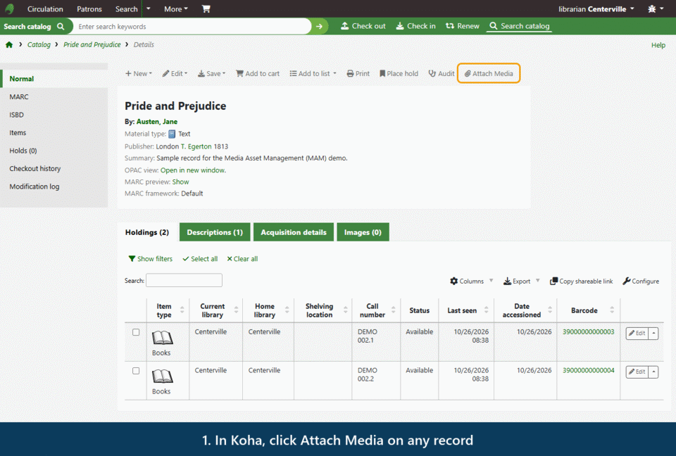
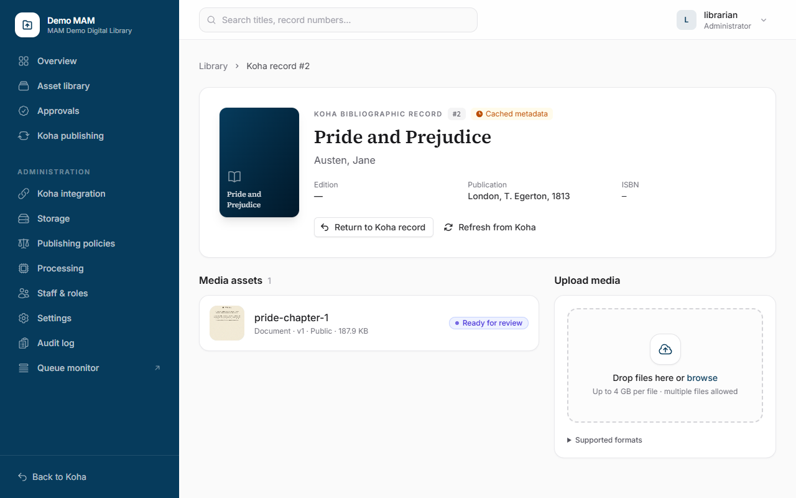
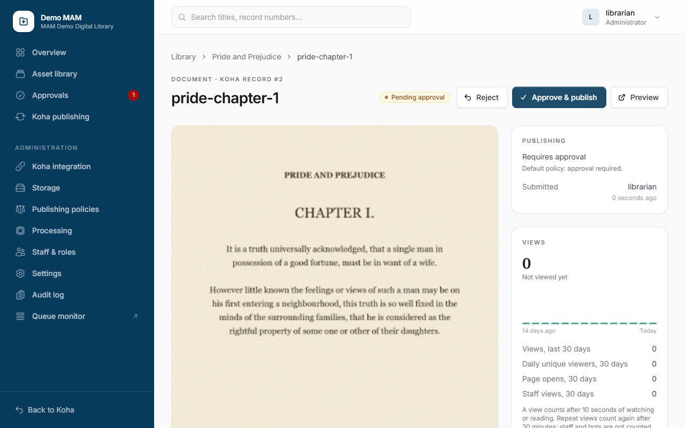
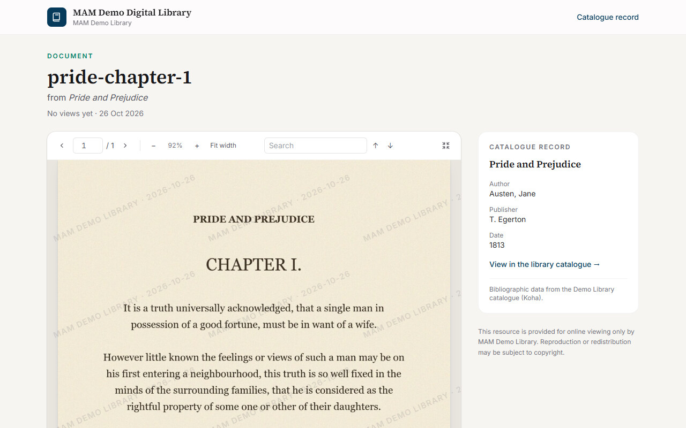
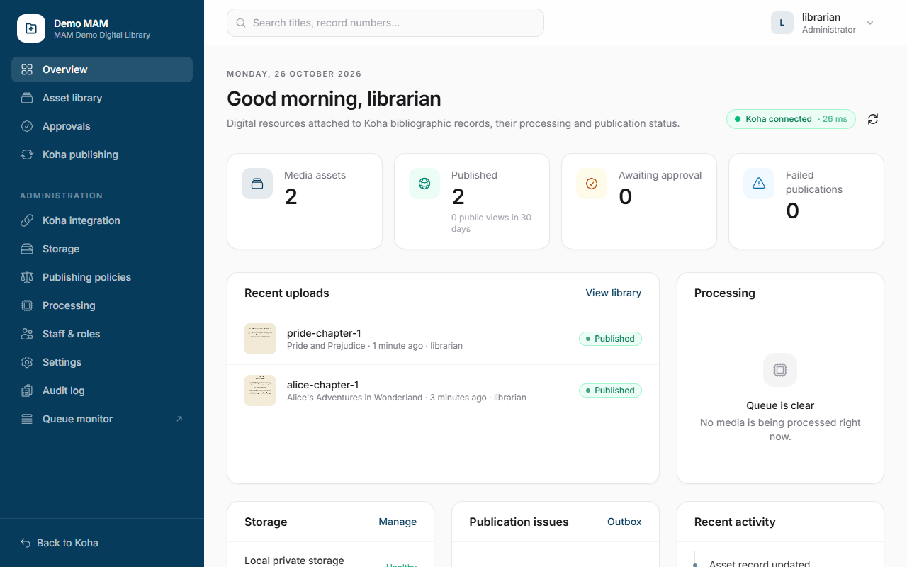

# MAM — Media Asset Management for Koha

**The digital media home for your Koha catalogue: upload, check, review, publish and view scans, documents,
images, audio and video — with one click from Koha and no second password.**

[](https://github.com/tahir242/koha-mam/actions/workflows/release.yml)
[](https://github.com/tahir242/koha-mam/releases)


**Version 1.1.1 (beta)** · Koha 26.05 (minimum 22.11) · Author: Tahir Ali Channa

> **Two parts, one product.** This repository is the **MAM application**. It works together with the Koha plugin
> **[koha-media-manager](https://github.com/tahir242/koha-media-manager)**, which adds the *Attach Media* button to
> Koha and signs staff in. Install both.

---

<p align="center">
  
</p>

> **Try it in one command.** [`demo/`](demo/README.md) runs Koha 26.05, the MAM and the Koha plugin, preconfigured:
> `cd demo && docker compose up -d --build`.

## Why libraries choose it

- **One click from the catalogue** — *Attach Media* on every record and for every item (its *Actions* menu or next to *Edit*).
- **No extra passwords** — secure single sign-on with Koha identities; Koha permissions stay in charge.
- **Record and item level** — attach media to a title or to one copy, even before it has a barcode.
- **Every common format** — PDF and Office documents, images, audio and video up to 4 GB, uploaded in resumable parts.
- **Safe by default** — validation, virus scanning, checksums and private storage; originals are never served.
- **Review before publishing** — configurable approval policies with a four-eyes rule.
- **Published into Koha** — record media as MARC 856, item media in the item's URL (952$u), every write verified.
- **A secure viewer** — document search, adaptive video streaming, audio and zoomable images; watermark, no downloads.
- **YouTube-style view counts** — real watching or reading, not page loads; repeats, bots and staff filtered out.
- **Flexible storage** — local disk, NAS or shared drive, S3 / MinIO.
- **Complete audit trail** — every sign-in, upload, decision and publication.

## How it works

```
 Koha (plugin)                       MAM                                              Koha catalogue / OPAC
 Attach Media ── signed in ──►  Upload ─► Scan ─► Prepare for viewing ─► Approve ─►  856 (record) · 952$u (item)
                                                                                      │
 Patrons and staff ◄──────────── Secure viewer (/view/…) with view statistics ◄────────┘
```

## Screenshots

| **Record workspace**: upload, processing status | **Review**: preview, approve and publish |
|---|---|
|  |  |
| **Secure viewer** for patrons: search, zoom, watermark | **Overview**: uploads, publications, processing |
|  |  |

Once published, the link appears in the Koha OPAC (MARC 856 for a record, the item's URL for an item):

<p align="center"></p>

## Quick start

1. **Install the Koha plugin** from [koha-media-manager releases](https://github.com/tahir242/koha-media-manager/releases).
2. **Download** `koha-mam-v1.1.1-beta.zip` from [Releases](https://github.com/tahir242/koha-mam/releases), unpack it on
   your web server and point the document root at `public/`.
3. **Configure** `.env` (Koha addresses, API key, and the Instance ID, Client ID and secret shared with the plugin), then:

   ```bash
   php artisan key:generate
   php artisan migrate --force --seed
   php artisan config:cache && php artisan route:cache && php artisan view:cache
   ```

4. **Start** the queue worker and the scheduler, then click **Attach Media** in Koha.

Full instructions: **[User Guide](docs/USER_GUIDE.md)**.

## Documentation

| Document | For |
|---|---|
| [User Guide](docs/USER_GUIDE.md) | Library staff and administrators: daily use, publishing, views, roles, installation, configuration, troubleshooting, FAQ |
| [Developer Guide](docs/DEVELOPER_GUIDE.md) | Developers and operators: architecture, data model, Koha integration, processing, delivery, view counting, security, testing, deployment, releases |
| [Changelog](CHANGELOG.md) | What changed in each release |
| [Koha plugin](https://github.com/tahir242/koha-media-manager) | The Koha side: User Manual, Developer Guide and the sign-in protocol |

## Requirements

- PHP 8.3+ (with `fileinfo`, `gd`, `intl`, `zip`, `mbstring`), Composer 2, Node 20+
- Nginx or Apache; MySQL/MariaDB, PostgreSQL or SQLite
- FFmpeg, Poppler, ImageMagick, LibreOffice; ClamAV for virus scanning
- Koha 26.05 (minimum 22.11) with the [koha-media-manager](https://github.com/tahir242/koha-media-manager) plugin

## Development

```bash
composer install && npm ci && npm run build
cp .env.example .env && php artisan key:generate && php artisan migrate --seed
php artisan test
```

Every push is tested by GitHub Actions, and every version tag publishes a release with a ready-to-deploy zip and
its change log — see the [Developer Guide](docs/DEVELOPER_GUIDE.md#15-continuous-integration-and-releases).

## Status

**Beta.** Runtime-tested with Koha 26.05 and the plugin: sign-in from records and items, uploads, processing,
publishing to 856 and 952$u, the viewer and view counting. Validate ClamAV, Office conversion, video, MinIO and
HTTPS on your staging server before production, and report issues on
[GitHub](https://github.com/tahir242/koha-mam/issues).

## License

MIT. © 2026 Tahir Ali Channa
