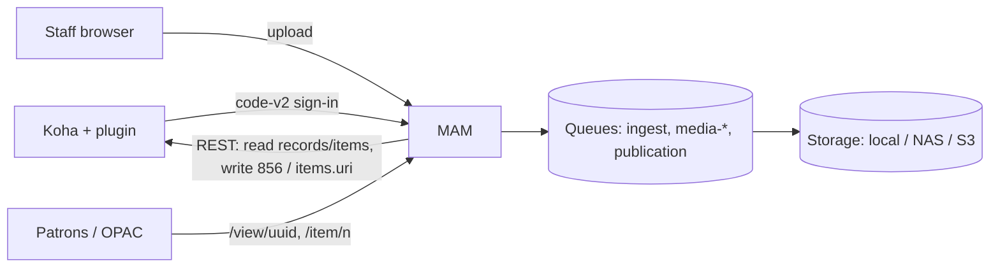

# MAM — Media Asset Management for Koha — Developer Guide

**Version 1.0.0 (beta)** · Laravel 13 · PHP 8.3+ · Author: Tahir Ali Channa

For developers, integrators and operators: architecture, data model, the Koha integration, processing,
delivery, view counting, security, testing, building, deployment and releases. Staff and administrators
should start with the [User Guide](USER_GUIDE.md). The Koha side lives in the companion repository
[koha-media-manager](https://github.com/tahir242/koha-media-manager), whose Developer Guide specifies the
sign-in protocol.

---

## Contents

1. [Architecture](#1-architecture)
2. [Project layout](#2-project-layout)
3. [Data model](#3-data-model)
4. [Authentication and authorisation](#4-authentication-and-authorisation)
5. [Koha integration](#5-koha-integration)
6. [Upload and processing pipeline](#6-upload-and-processing-pipeline)
7. [Storage](#7-storage)
8. [Asset lifecycle and publishing](#8-asset-lifecycle-and-publishing)
9. [Public viewer and delivery](#9-public-viewer-and-delivery)
10. [View counting](#10-view-counting)
11. [Security](#11-security)
12. [Commands and scheduler](#12-commands-and-scheduler)
13. [Testing](#13-testing)
14. [Building and deploying](#14-building-and-deploying)
15. [Continuous integration and releases](#15-continuous-integration-and-releases)
16. [Contributing](#16-contributing)

---

## 1. Architecture

A modular Laravel monolith that runs on its own server (or beside Koha, fully isolated: own directory,
database, virtual host, queue and release cycle). It never touches Koha's database and never modifies Koha
or the plugin.



**Data ownership.** Koha owns bibliographic data, MARC21, staff identity and permissions. The MAM stores
files, derivatives, versions, workflow state, access rules, view statistics and audit data, plus a
lightweight identity per staff member (no password) and a **snapshot** of display metadata per asset so the
viewer never depends on Koha being reachable.

| Area | Location | Responsibility |
|---|---|---|
| Authentication | `app/Auth` | Koha sign-in (`CodeExchangeAdapter`, code-v2), identity upsert (`StaffLogin`) |
| Authorisation | `app/Enums/Capability.php`, `config/dam.php`, `app/Policies` | Capabilities, roles, gates and policies |
| Koha | `app/Koha` | REST client, typed exceptions, cached record/item metadata, MARCXML editing (`Marc/Managed856`), item URI (`ManagedItemUri`) |
| Assets | `app/Models`, `app/Assets`, `app/States/Asset` | Assets, versions, files, upload intake, lifecycle state machine |
| Processing | `app/Media`, `app/Assets/VersionPipeline.php`, `app/Jobs` | Type registry, malware scanning, processors, jobs |
| Publishing | `app/Publishing` | Policies, workflow actions, publication outbox (`PublicationService`) |
| Storage | `app/Storage` | Flysystem backends (local, NAS, shared, S3/MinIO) |
| Delivery | `app/Delivery`, `MediaController`, `PublicViewerController` | Access rules, signed URLs, streaming, HLS rewriting, **view counting** (`ViewCounter`) |
| UI | `app/Livewire`, `resources/views`, `resources/js` | Staff app (Livewire 4 + Flux) and the public viewer (vanilla JS) |
| Operations | `app/Health`, `routes/console.php` | Health checks, scheduler, commands, audit |

**Main packages:** livewire/livewire, livewire/flux, laravel/horizon, spatie/laravel-model-states,
spatie/laravel-activitylog, spatie/laravel-health, league/flysystem-aws-s3-v3, pion/laravel-chunk-upload,
enshrined/svg-sanitize; npm: pdfjs-dist, hls.js. Deliberately not used: spatie/laravel-medialibrary
(runtime-chosen backends, multi-file HLS, versioning), spatie/laravel-permission (fixed capability set),
FFmpeg wrappers (explicit argument arrays are easier to audit), MARC libraries (targeted DOM edits preserve
every other node).

## 2. Project layout

```
app/Auth            Koha sign-in and session creation
app/Koha            Koha REST client, record/item repositories, MARC 856 and item URI handling
app/Assets          Upload intake and version pipeline
app/Media           Type detection, processors, malware scanning, ToolRunner
app/Publishing      Workflow, publishing policies, publication outbox
app/Delivery        Access rules, media responses, view counting
app/Storage         Storage backends
app/Livewire        Staff and administration pages
config/dam.php      All MAM settings (every value overridable from the environment)
routes/web.php      Public viewer, media, engagement, sign-in and staff routes
routes/console.php  Commands and schedule
resources/js        app.js (staff, chunked uploader), viewer.js (public viewer, view tracking)
tests/              Feature and unit tests (tests/Support/FakeKoha.php)
docs/               USER_GUIDE.md, DEVELOPER_GUIDE.md
```

## 3. Data model

Separate database (MySQL/MariaDB or PostgreSQL; SQLite in tests). Koha identifiers are plain indexed
columns qualified by `koha_instance_id`; there are no foreign keys into Koha.

| Table | Purpose | Notable columns |
|---|---|---|
| `users` | Koha staff identities, no passwords | `koha_instance_id`, `koha_patron_id` (unique together), `koha_userid`, `role`, `is_active` |
| `digital_assets` | One resource | `uuid` (public id), `biblio_id`, `item_id`, `media_type`, `state`, `access_level`, `is_sensitive`, `marc_relationship`, `link_text`, `public_note`, `current_version_id`, `biblio_snapshot`, `item_snapshot`, `view_count`, `last_viewed_at`, workflow columns, soft deletes |
| `asset_versions` | One uploaded file | `version_number`, `status`, processing progress/error, `checksum_sha256`, `detected_mime`, `metadata` (dimensions, duration, pages), `is_viewable` |
| `asset_files` | One stored object | `role` (`original`, `viewer_pdf`, `page_image`, `thumbnail`, `poster`, `image_large`, `image_medium`, `hls_master`, `audio`), `storage_backend_id`, randomised `path`, checksum |
| `storage_backends` | Configured storage | `key`, `driver`, `settings` (never secrets), `allowed_media_types`, `is_default`, health |
| `publishing_policies` | Approval rules | conditions (role, media type, access, sensitivity), `requires_approval`, `priority` |
| `publication_operations` | Koha outbox | `biblio_id`, `item_id`, `action` (link/unlink), `status`, `attempts`, `available_at`, MARC hashes, `field_856`, `diagnostics` |
| `media_access_events` | Viewer analytics | `event` (`open`/`view`), `counted`, `reason`, `visitor_hash` (daily-rotated HMAC), `referrer_host`, `user_agent_family`, `is_staff` |
| `app_settings` | Admin-managed non-secret settings | key → JSON |
| framework | `activity_log`, `sessions`, `cache`, `cache_locks`, `jobs`, `failed_jobs` | |

State changes go only through `spatie/laravel-model-states` transitions. Only `digital_assets` is
soft-deleted, so audit and publication history stay meaningful.

## 4. Authentication and authorisation

Staff have no MAM password; every session starts in Koha through the plugin's **code-v2** hand-off
(full contract: plugin [Developer Guide § 5](https://github.com/tahir242/koha-media-manager/blob/main/docs/DEVELOPER_GUIDE.md#5-sign-in-protocol-code-v2)).

```
Koha ──303──► /sso/koha/start?request=…             MAM stores a single-use browser state (≤5 per session, 120 s)
MAM  ──303──► Koha run.pl …&op=continue&request&state   fixed URL, never from input
Koha ──303──► /sso/koha?code=…&state=…              state must match this browser before any exchange
MAM  ──POST─► {KOHA_STAFF_URL}/api/v1/contrib/media-manager/exchange   X-Media-Client / X-Media-Secret, {"code"}
Koha ──200──► identity, context {biblio_id, branch, item_id}, capabilities, state
MAM  ──303──► /staff/biblios/{biblio}[?item={item}] (or /staff without a record)   session regenerated, capability ceiling stored
```

`CodeExchangeAdapter` verifies protocol, issuer = instance, audience, provider, positive integer ids
(`item_id` optional; `biblio_id` null only together with a null `item_id`, for the plugin dashboard's
**Go to MAM**), known capabilities including `media.access`, timestamps, correlation id and the
returned state (constant time). Identities are upserted by `(koha_instance_id, patron_id)`.

**Effective rights = MAM role ∩ Koha capability ceiling.**

| Koha capability | MAM capabilities allowed |
|---|---|
| `media.access` | `media.view_dashboard` |
| `media.upload` | upload, edit, replace, submit |
| `media.manage` | review, approve, publish, unpublish, delete, view audit |
| `media.admin` | manage storage, manage settings |

| Role | Capabilities before the ceiling |
|---|---|
| cataloguer | view dashboard, upload, edit, replace, submit |
| trusted_cataloguer | + publish, unpublish |
| reviewer | + review, approve, view audit |
| administrator | all |
| suspended | none |

Checks run server-side in gates/policies, workflow guards (`AssetWorkflow`), Livewire `boot()` authorisation
and `EnsureStaffSession` (which re-applies the ceiling on every request). `GET /.well-known/koha-media-manager`
advertises the protocol for the plugin's connection test. `php artisan dam:sso:doctor` prints and validates
the effective configuration.

## 5. Koha integration

Only the REST API (`/api/v1` at `KOHA_STAFF_URL`), OPAC cover images and the plugin hand-off are used.

| Call | Purpose | API user permission |
|---|---|---|
| `POST /oauth/token` (`client_credentials`) | Access token (cached; refreshed once on 401) | `RESTOAuth2ClientCredentials` on |
| `GET /biblios/{id}` (JSON, MARCXML) | Display metadata, framework, MARC for 856 editing | `catalogue` |
| `PUT /biblios/{id}` (MARCXML, `x-framework-id`) | Write the managed 856 | `editcatalogue: edit_catalogue` |
| `GET /items/{id}` | Item ownership, barcode/copy/call number, current `uri` | `catalogue` |
| `PUT /biblios/{id}/items/{item_id}` `{"uri": …}` | Write the item link (952$u) | `editcatalogue: edit_items` |

Responses map to typed exceptions: connection/5xx/429 → `KohaUnavailableException` (retry), 409 →
`KohaConflictException` (retry), 404 → `KohaRecordNotFoundException` (permanent), 401/403 →
`KohaAuthorizationException` (permanent), other 4xx → `KohaRejectedException` (permanent).

`BiblioRepository` and `ItemRepository` cache metadata (`KOHA_METADATA_CACHE_TTL`) with a last-known-good copy
for outages; publication always reads live data. Covers are proxied from
`opac-image.pl` through `/covers/{biblio}` only for records with published public media (or for staff).

## 6. Upload and processing pipeline

```
POST /staff/uploads (Content-Range chunks, 8 MB default, capped by PHP limits)
 └ UploadIntake: size, extension allowlist, content-detected MIME, quota, duplicate check (record/item)
    └ quarantine (random name) → IngestAssetVersion [ingest]
        ├ re-validate type and checksum
        ├ malware scan (ClamAV) → infected: destroyed, version failed, security event
        └ store original → ProcessAssetVersion [media-documents | media-images | media-audio | media-video]
            ├ working copy (checksum verified) → processor → derivatives → verify
            └ version ready → asset ready_for_review (replacement of a published asset: awaiting activation)
```

| Type | Derivatives | Tools |
|---|---|---|
| Document | `viewer_pdf`, `thumbnail`, optional `page_image` per page | LibreOffice (isolated profile), Poppler; calibre for EPUB |
| Image | `image_large` 2400 px, `image_medium` 1200 px, `thumbnail` 480 px (WebP, EXIF stripped) | ImageMagick with resource limits; SVG sanitised and rasterised |
| Video | `hls_master` + H.264/AAC renditions 360/720/1080p (capped at source), `poster`, `thumbnail` | FFmpeg, ffprobe |
| Audio | `audio` (AAC/MP4 fast-start) | FFmpeg, ffprobe |

**Safety:** `ToolRunner` uses Symfony Process with argument arrays (no shell; generated filenames);
ImageMagick limits and a megapixel guard against decompression bombs; capped FFmpeg threads; `nice` on Linux;
per-type timeouts; idempotent jobs; scratch directories removed in `finally`; unvalidated content is never
publishable. Add a format in the registry, or a type by implementing `App\Media\Processors\MediaProcessor`.

## 7. Storage

Backends are rows in `storage_backends`, resolved at runtime by `StorageManager` (`Storage::build()`):
`local`, `nas` and `shared` (OS-mounted paths) and `s3` (MinIO or any S3-compatible store). Everything is
private (`0640`/`0750`; roots inside `public/` refused; private S3 objects proxied with range support). S3
credentials stay in the environment (named profiles); the database never holds secrets. The default backend
receives new uploads; backends can be limited by media type; each file keeps its own backend id, so files can
be migrated without changing public links.

```
{root}/{uuid[0..1]}/{asset-uuid}/{version-uuid}/original/{random}.{ext}
{root}/{uuid[0..1]}/{asset-uuid}/{version-uuid}/derivatives/{document.pdf|large.webp|thumbnail.*|poster.jpg|audio.m4a|hls/…}
```

`StorageManager::probe()` writes, reads back and deletes a probe object and records free space (warning
below 10 %).

## 8. Asset lifecycle and publishing

```
draft → uploaded → validating → processing → ready_for_review ─┬─► pending_approval → approved ─┐
                         └────────► processing_failed ─retry─┘                                  │
ready_for_review / unpublished ─(policy allows direct publish)─────────────────────────────────┤
                                                                                                 ▼
                                            publication_pending ─verified─► published ─► unpublished ─► archived
                                                    └─failure─► publication_failed ─retry─┘
```

**Policies** (`PublishingPolicyResolver`): sensitive → approval; no `media.publish` → approval; per-asset
override; highest-priority matching policy; then the default. Four-eyes: reviewers cannot approve their own
submissions. Rejections need a reason.

**Outbox** (`PublicationService`, queue `publication`, one writer per record via a cache lock):

- **Record media (856):** fetch JSON + MARCXML → apply the managed 856 to a copy → re-read and restart if the
  record changed (up to 3×) → PUT with the original framework → read back → verify exactly one expected
  managed 856 and every pre-existing field (005/999 ignored).
- **Item media (952$u):** read the item → add or remove `{public_url}/item/{itemnumber}` in `uri`, keeping
  other URIs (" | " separated) → PUT `{"uri"}` → read back and verify → only then remove any 856 an earlier
  build wrote for that asset. The link stays while any item media is published.

Transient failures back off (`60s, 2m, 5m, 15m, 30m, 1h…`) up to `DAM_PUBLICATION_MAX_ATTEMPTS`; permanent
ones fail with a retry button; a failed read-back becomes `needs_review`. `dam:publications:relay` (every
minute) dispatches due operations and recovers stuck ones. Newer intents supersede older pending ones.

| 856 element | Value |
|---|---|
| Ind1 / Ind2 | `4` (HTTP) / relationship: `0` resource, `1` version, `2` related, blank |
| `$3` | Full text, Image, Video recording, Audio recording |
| `$u` | `{public_url}/view/{uuid}` (identifies managed fields; no private markers) |
| `$y` / `$z` | Link text / public note (restricted default note) |
| `$7` | `0` open access, `1` restricted |

`php artisan dam:items:republish` moves item media published as 856 by earlier builds to the item URI.

## 9. Public viewer and delivery

| Route | Purpose |
|---|---|
| `GET /view/{uuid}` | Public viewer (published + public, or staff for any state with a preview banner) |
| `GET /item/{itemnumber}` | Item link from 952$u: redirects to the only viewable resource, or lists several |
| `POST /view/{uuid}/engagement` | View report (section 10) |
| `GET /media/{uuid}/{file}`, `/media/{uuid}/{file}/hls/{path}` | Signed, expiring derivative delivery |
| `GET /covers/{biblio}` | Cover proxy |

`MediaAccess` is the single authority: public = published + public + viewable current version + derivative
role; staff = any derivative; nobody = the original. Everything else is **404** so identifiers cannot be
probed. Media URLs are signed and expiring (`DAM_SIGNED_URL_TTL`), access is re-checked on every request, HLS
playlists are rewritten to signed URLs with a strict path allowlist, cross-site requests are refused and
responses carry `nosniff`, a sandbox CSP and `noindex`. `DAM_DELIVERY_DRIVER=x-accel` / `x-sendfile` hands
streaming to Nginx / Apache.

The viewer bundle (`resources/js/viewer.js`) is vanilla JS under a strict nonce CSP (no `unsafe-eval`):
PDF.js for documents, hls.js (or native HLS) for video, `<audio>`, and a zoomable image stage; no download
or print controls; a configurable watermark.

## 10. View counting

YouTube-style: views measure **engagement**, are verified server-side, and are filtered for repeats, bots
and staff. Implemented in `App\Delivery\ViewCounter`.

```mermaid
sequenceDiagram
    participant B as Browser (viewer.js)
    participant M as MAM
    B->>M: GET /view/{uuid}
    M->>M: record "open"; issue encrypted token {asset, nonce, issued_at}
    M-->>B: page with data-view-token, data-view-seconds
    B->>B: accumulate playback time (audio/video) or visible time (documents/images)
    B->>M: POST /view/{uuid}/engagement {token}   (once, when the threshold is reached)
    M->>M: verify token, elapsed ≥ threshold, single use, not bot/staff/preview, viewer limits
    M-->>B: {counted, views}
```

| Step | Rule |
|---|---|
| Open | Every viewer page load is an `open` event (no count). |
| Threshold | `qualifying_seconds`: video 30, audio 30 (half the duration when shorter, from version metadata), document 10, image 5. The browser counts real playback time (no seeking, not while paused) or visible-page time. |
| Token | `Crypt::encryptString` of `{a: asset id, n: random nonce, t: issued at}`; valid for 6 h; must match the asset; elapsed time must be ≥ threshold − 2 s; single use (`Cache::add` on the nonce). Forged, expired, early or reused tokens are refused. |
| Filters | Unpublished → `preview`; bot user agents (crawlers, previews, HTTP libraries, empty) → `bot`; staff sessions → `staff` (unless `count_staff`). |
| Repeats | Viewer key = HMAC(app key, IP + user agent), kept only in the cache until the end of the day. Counted again only after `repeat_after_minutes` (30), at most `max_per_viewer_per_day` (5) per asset → `repeat` / `daily_cap`. Guarded by a cache lock. |
| Count | Counted views increment `digital_assets.view_count` (query-builder increment: no `updated_at` bump, no activity log) and set `last_viewed_at`. Every report is stored as a `view` event with `counted` and `reason`. |
| Privacy | No IP is stored; events keep a daily-rotated `visitor_hash`, used for "daily unique viewers". Events are pruned after `DAM_ACCESS_EVENT_RETENTION_DAYS`. |

The engagement route is rate-limited (`throttle:views`, 30/min per IP) and exempt from CSRF
(`PreventRequestForgery`) because it is authorised by the token, not by a session. Display helpers:
`DigitalAsset::viewsLabel()` ("1,234 views") and `viewsShort()` ("1.2K views"). Staff analytics are computed in
`AssetDetail::viewStats()`; the library sorts by `view_count`; the dashboard lists the most viewed.

Configuration: `config('dam.viewer.views')` (`DAM_VIEW_*`); `DAM_RECORD_VIEWS=false` disables opens and views.

## 11. Security

| Area | Control |
|---|---|
| Authentication | Koha-only code-v2; single-use code and browser state; session regeneration; idle and absolute limits; suspended identities refused |
| Sessions | Secure (production), HttpOnly, SameSite=Lax, encrypted, dedicated cookie name |
| CSRF | On every state-changing request except the token-authorised engagement endpoint |
| Authorisation | Capability gates/policies, workflow guards, per-request re-validation including Livewire actions |
| Uploads | Content-based type detection, extension allowlist, size checks before and after receipt, daily quota, rate limits, random quarantine names, SHA-256, duplicate detection, mandatory malware scan in production |
| Processing | No shell, generated names, resource limits, bomb guard, SVG sanitisation, isolated LibreOffice profiles |
| Storage | Private only; no backend in the web root; no secrets in the database |
| Delivery | No route serves originals; signed expiring URLs; per-request access checks; HLS allowlist; sandbox CSP; cross-site blocking; rate limits |
| HTTP | Nonce CSP (strict on public pages), `X-Frame-Options: DENY`, `Referrer-Policy`, `Permissions-Policy`, HSTS on HTTPS |
| XML | MARCXML parsed without network access or entity expansion; DOCTYPEs rejected |
| Koha | Least-privilege API user; framework preserved; read-back verification; never writes Koha's database |
| Audit | spatie/activitylog for sign-in, uploads, workflow, publication, processing, security and settings; correlation ids; no secrets or file contents logged |

**Production checklist:** `APP_ENV=production`, `APP_DEBUG=false`, HTTPS only, `DAM_ALLOW_INSECURE_HTTP=false`
(and *Allow HTTP* off in the plugin), strong unique `KOHA_SSO_CLIENT_SECRET`, ClamAV required, least-privilege
Koha API user, `TRUSTED_PROXIES` behind a proxy, `/sso/koha` query strings excluded from access logs, storage
roots outside `public/` (`0750`), `DAM_HEALTH_TOKEN` if `/health.json` is monitored, `optimize` after every
deployment.

## 12. Commands and scheduler

| Command | Purpose | Schedule |
|---|---|---|
| `dam:sso:doctor` | Print and validate sign-in configuration; probe the Koha exchange route | manual |
| `dam:publications:relay` | Dispatch due outbox operations; recover stuck ones | every minute |
| `dam:items:republish` | Move item media from record 856 to the item URI | manual, once |
| `dam:cleanup` | Remove stale work folders and abandoned quarantine files | hourly |
| `activitylog:clean`, `model:prune` | Audit and view-event retention | daily |
| health checks, `horizon:snapshot` | Monitoring | every minute / 5 minutes |

Queues: `publication`, `ingest`, `default`, `media-images`, `media-documents`, `media-audio`, `media-video`.
Horizon (`config/horizon.php`) supervises them with low priority for media work; with the database queue a
single `queue:work --queue=…` worker processes all of them.

## 13. Testing

```bash
php artisan test
```

> On a machine where `config:cache` has been run, never run the tests directly: Laravel would ignore
> `phpunit.xml` and `RefreshDatabase` would wipe the live database (`tests/TestCase.php` refuses to start).
> Use separate cache paths:
>
> ```bash
> APP_CONFIG_CACHE=storage/framework/testing-config.php APP_ROUTES_CACHE=storage/framework/testing-routes.php php artisan test
> ```

144 tests (PHPUnit 12, SQLite in memory, array cache, sync or faked queue, temporary storage). No test contacts
a real Koha: `tests/Support/FakeKoha.php` doubles the REST API (token, records, items, PUTs) and scripts
failures, deletions, concurrent edits and lost writes.

| Area | Tests |
|---|---|
| Sign-in | `CodeV2SsoTest` — full hand-off, state rules, response validation, error mapping, capability ceiling, item context |
| MARC | `Unit/MarcRecordTest` — 856 generation, preservation, idempotency, targeted removal, XXE rejection |
| Publishing | `PublicationTest` — verified 856 and item URI publication, retries, failures, concurrency, unpublish, migration command |
| Workflow | `WorkflowTest` — policies, permissions, four-eyes, rejection, transitions |
| Uploads | `UploadTest` — validation, limits, duplicates, quota, chunking, replacement, item uploads |
| Processing | `ProcessingPipelineTest` — routing, malware, checksums, ImageMagick pipeline (skipped without ImageMagick), no-shell |
| Public access | `PublicAccessTest` — access rules, CSP, signed URLs, HLS, headers, cross-site blocking |
| Views | `ViewCountingTest` — opens vs views, thresholds, tokens, repeats and daily cap, bots, staff, previews, analytics |
| Storage, staff UI | `StorageTest`, `StaffAccessTest` |

Before go-live, verify on staging: ClamAV, LibreOffice conversion, video and audio, MinIO, and HTTPS.

## 14. Building and deploying

```bash
composer install --no-dev --optimize-autoloader
npm ci && npm run build                       # also copies the PDF.js assets
cp .env.example .env && php artisan key:generate
php artisan migrate --force --seed
php artisan config:cache && php artisan route:cache && php artisan view:cache
```

On Windows add `--ignore-platform-req=ext-pcntl --ignore-platform-req=ext-posix` (Horizon) and use
`queue:work`.

**Production outline (Debian/Ubuntu):** PHP-FPM in a dedicated pool and user; Nginx server block with the root
on `public/`, `client_max_body_size 20m`, an `internal` location per filesystem backend for
`DAM_DELIVERY_DRIVER=x-accel`, and SSO query strings excluded from access logs; MariaDB database separate from
Koha's; Redis with dedicated DB numbers and prefixes; Horizon as a systemd service with `Nice`, `CPUQuota`
and `MemoryMax` so conversions never starve Koha; the scheduler in cron.

**Updating:** `php artisan down` → deploy → `composer install --no-dev -o` → `npm ci && npm run build` →
`php artisan migrate --force && php artisan optimize && php artisan horizon:terminate` → `php artisan up`.

**Backup:** nightly database dump; snapshots of every storage root (originals first — derivatives can be
regenerated); `.env` in a secrets vault. Redis needs no backup (the outbox lives in the database).

## 15. Continuous integration and releases

`.github/workflows/release.yml`:

| Job | When | What |
|---|---|---|
| **test** | Every push and pull request | PHP 8.4 + Node: `composer install`, `npm ci && npm run build`, `php artisan test` |
| **package** | After tests | Production build (`composer install --no-dev`, built assets) packed as `koha-mam-<ref>.zip`, uploaded as an artifact |
| **release** | Tags `v*` | Checks the tag against `config('dam.version')`, takes that version's section of `CHANGELOG.md` as notes, and publishes a GitHub Release with the zip (the Latest release for plain and `-beta` tags; a pre-release for `-alpha`, `-rc` and `-dev`) |

**Cutting a release:** set `'version'` in `config/dam.php`, add a `## [x.y.z] - date` section to
`CHANGELOG.md`, commit, then `git tag -a vx.y.z -m vx.y.z && git push origin main --follow-tags`.

The release zip contains the application with production dependencies and built assets — no `.env`,
database, uploads, tests or development tooling.

## 16. Contributing

- Keep changes covered by tests; run the suite with separate cache paths.
- Format PHP with Pint (`vendor/bin/pint`).
- Never commit `.env`, databases, storage contents or credentials.
- All state changes through `AssetWorkflow`; all access decisions through `MediaAccess`.
- Bump the version and add a changelog entry for every release.
